# Solidari — Fase 7: consolidação em Oracle PL/SQL e entrega contínua

**Atividade:** Cap 1 — Consolidando o Smart HAS (DevOps & DevSecOps)  
**Grupo 41**  
Bruno Martins Fadiga — RM 557433  
Giovanni Silva Testoni — RM 99960  
Marcos Andrey da Silva — RM 555047  
Vinícius Moraes Vianna — RM 555046  
Vitória Camila dos Santos Candido — RM 556604  
**Repositório:** https://github.com/BFadiga/solidari  
**Vídeo de apresentação:** _inserir link do YouTube (não listado)_

---

## 1. Visão geral

O Solidari transforma consumo em doação: o participante compra num parceiro, a
compra gera cashback, e o crédito vira doação convertida em impacto (árvores
plantadas ou refeições servidas).

Nesta fase a solução foi consolidada em duas frentes:

- **Parte 1 — Oracle PL/SQL.** O banco passou de PostgreSQL para Oracle. As regras
  de negócio foram reorganizadas em **5 packages**, ganharam **3 triggers** de
  auditoria e automação, e o painel passou a ter consultas flexíveis com
  **Dynamic SQL**.
- **Parte 2 — CI/CD.** Um pipeline no **GitHub Actions** compila e testa as três
  aplicações a cada push, testa o back-end contra um Oracle real, faz o deploy
  automatizado da API ligada ao Oracle e publica logs e relatórios de cada execução.



O app Android e o painel Angular não mudaram de contrato: continuam falando com a
mesma API REST. Toda a mudança ficou concentrada no back-end e no banco.

---

## 2. Migração de PostgreSQL para Oracle

O schema e as rotinas foram reescritos para Oracle, com compatibilidade a partir da
versão **19c** (o mesmo SQL roda no Oracle Database Free 23ai usado em Docker e no
pipeline).

| Ponto | PostgreSQL (antes) | Oracle (agora) | Por quê |
|---|---|---|---|
| Chave primária | `BIGSERIAL` | `GENERATED BY DEFAULT AS IDENTITY` | equivalente nativo desde o 12c |
| Flags | `BOOLEAN` | `NUMBER(1)` + `CHECK (0,1)` | coluna `BOOLEAN` só existe no 23ai |
| Datas | `now()` | `LOCALTIMESTAMP` | mesmo fuso que o `LocalDateTime` do Java |
| Massa simulada | `generate_series` + `md5` | `CONNECT BY LEVEL` + `ORA_HASH` | mantém a carga determinística |
| Erros de negócio | `SQLSTATE` próprio (`SL001`) | `RAISE_APPLICATION_ERROR(-20001)` | faixa -20000..-20999 reservada ao usuário |
| Rotinas | functions/procedures soltas | **packages** | organização, encapsulamento e reuso |

Uma diferença de comportamento exigiu cuidado: no PostgreSQL, um erro dentro de
um bloco `BEGIN ... EXCEPTION` desfaz o bloco inteiro; no Oracle, desfaz **só o
comando que falhou**. Na apuração de cashback, cada item agora começa com um
`SAVEPOINT` e o tratamento de erro faz `ROLLBACK TO SAVEPOINT`, garantindo que uma
compra com problema nunca deixe crédito pela metade.

Todas as mudanças são versionadas pelo **Flyway** (`backend/src/main/resources/db/migration`),
que aplica as migrações na subida da API:

| Migração | Conteúdo |
|---|---|
| `V1__schema_inicial.sql` | tabelas, constraints, índices e a nova `auditoria_saldo` |
| `V2__dados_simulados.sql` | 12 parceiros, 16 usuários, compras e doações |
| `V3__pkg_util.sql` | package `pkg_util` |
| `V4__pkg_carteira.sql` | package `pkg_carteira` |
| `V5__pkg_operacoes.sql` | packages `pkg_cashback` e `pkg_monitoramento` |
| `V6__pkg_relatorios_dynamic_sql.sql` | package `pkg_relatorios` (Dynamic SQL) |
| `V7__triggers.sql` | as três triggers |

---

## 3. Parte 1 — objetos PL/SQL

### 3.1 Por que packages

Cada package tem duas partes:

- **Especificação (spec):** o que é público — as rotinas que a API pode chamar e as
  constantes globais.
- **Corpo (body):** a implementação. Pode mudar à vontade sem afetar quem chama,
  desde que a especificação continue igual.

O agrupamento seguiu o motivo de mudança de cada regra: carteira, apuração
financeira, monitoramento e relatórios mudam por razões diferentes. Isso também
permite dar `GRANT EXECUTE` em um package sem expor os demais.

### 3.2 Packages

**`pkg_util` — utilitários compartilhados**

| Objeto | Tipo | Finalidade | Valor agregado |
|---|---|---|---|
| `c_erro_*` (7 constantes) | variáveis globais | códigos de erro de negócio (-20001 a -20007) | o Java distingue regra de negócio de falha técnica pelo número, sem ler texto |
| `fn_moeda_br` | function | formata valor no padrão `1.234,56` | resultado independe da configuração NLS do servidor |
| `sp_erro` | procedure | levanta erro padronizado | todas as mensagens saem no mesmo formato |

**`pkg_carteira` — doações e indicadores**

| Objeto | Tipo | Finalidade | Valor agregado |
|---|---|---|---|
| `c_valor_arvore`, `c_valor_refeicao` | variáveis globais | "preço" de uma árvore (R$ 10) e de uma refeição (R$ 5) | mudar a conversão de impacto é alterar uma linha |
| `sp_registrar_doacao` | procedure | valida, debita o saldo e grava a doação | operação atômica; `SELECT ... FOR UPDATE` impede gastar o mesmo saldo duas vezes |
| `sp_impacto_usuario` | procedure (OUT) | árvores, refeições e total doado | indicador calculado perto dos dados, igual para app e painel |
| `fn_extrato_formatado` | function | extrato em texto pt-BR, percorrido por cursor explícito | tela de extrato pronta, sem formatação no app |
| `fn_ranking_doador` | function | posição no ranking de doadores | pode ser usada dentro de qualquer `SELECT` |

**`pkg_cashback` — apuração em lote**

| Objeto | Tipo | Finalidade | Valor agregado |
|---|---|---|---|
| `c_limite_padrao` | variável global | teto de compras por execução (500) | controla o tamanho do lote |
| `sp_processar_cashback` | procedure | apura o crédito das compras pendentes e soma ao saldo | `SAVEPOINT` por item: uma falha não derruba o lote; `WHERE status = 'PENDENTE'` evita crédito duplicado |

**`pkg_monitoramento` — alertas operacionais**

| Objeto | Tipo | Finalidade | Valor agregado |
|---|---|---|---|
| `c_saldo_minimo_parado`, `c_dias_*` | variáveis globais | limiares das regras | regras ajustáveis em um só lugar |
| `fn_alerta_aberto` | function **privada** | verifica se já existe alerta igual em aberto | rodar a rotina de novo não duplica alertas |
| `sp_gerar_alertas` | procedure | crédito parado, parceiro sem movimento, compras com erro | painel mostra o que precisa de ação humana |

**`pkg_relatorios` — consultas flexíveis (Dynamic SQL)** — detalhado na seção 3.4.

### 3.3 Triggers

| Trigger | Momento / nível | O que faz | Valor agregado |
|---|---|---|---|
| `trg_auditoria_saldo` | `AFTER UPDATE OF saldo`, por linha, com `WHEN (NEW.saldo <> OLD.saldo)` | grava em `auditoria_saldo` o saldo anterior, o novo, a diferença, se foi crédito ou débito, o usuário do banco e o programa (`SYS_CONTEXT`) | nenhum caminho altera saldo sem deixar rastro, nem um `UPDATE` feito direto no banco |
| `trg_transacao_status` | `BEFORE UPDATE OF status`, por linha | ao sair de PENDENTE, carimba `processada_em`; ao voltar para PENDENTE, limpa erro, cashback e data | dados sempre coerentes, sem depender de quem fez o `UPDATE` |
| `trg_alerta_transacao_erro` | `AFTER UPDATE OF status`, por linha, `WHEN (NEW.status = 'ERRO')` | abre um alerta CRÍTICO com o motivo da falha | o problema aparece no painel na hora, sem esperar o monitoramento |

As triggers são criadas **depois** da carga simulada (V7 vem após V2), para que a
massa de demonstração não gere auditoria nem alertas artificiais.

### 3.4 Dynamic SQL

O painel administrativo precisa filtrar compras por qualquer combinação de status,
parceiro, categoria, período e valor mínimo, ordenar por colunas diferentes e
agrupar o resumo por dimensões diferentes. Com SQL estático seria preciso um
comando por combinação, ou um `WHERE` cheio de `(:x IS NULL OR col = :x)` que o
otimizador não aproveita bem.

| Objeto | Tipo | Finalidade |
|---|---|---|
| `fn_buscar_transacoes` | function → `SYS_REFCURSOR` | monta o `SELECT` só com os filtros informados e abre com `OPEN ... FOR ... USING` |
| `fn_resumo_transacoes` | function → `SYS_REFCURSOR` | `GROUP BY` escolhido em tempo de execução: PARCEIRO, CATEGORIA, STATUS ou MES |
| `fn_sql_busca` | function | devolve o texto do SQL montado (usado em testes e na demonstração) |

**Segurança.** Nada digitado pelo usuário é concatenado no comando:

- valores de filtro entram sempre como **bind variables** (`:status`, `:valor_minimo`...);
- o que não aceita bind (coluna do `ORDER BY`, expressão do `GROUP BY`) vem de uma
  **lista fechada** dentro do package — valor fora da lista gera o erro -20007.

**Técnica de binds fixos.** O `OPEN ... FOR ... USING` exige uma lista de binds
fixa. Filtro informado vira uma condição real; filtro ausente vira uma condição
neutra que usa o mesmo bind:

```sql
-- fn_sql_busca(p_status => 'ERRO', p_valor_minimo => 100) gera:
SELECT t.id, u.nome AS usuario, p.nome AS parceiro, ...
  FROM transacoes t JOIN usuarios u ON ... JOIN parceiros p ON ...
 WHERE 1 = 1
   AND t.status = :status          -- filtro informado
   AND :parceiro_id IS NULL        -- filtro ausente (bind nulo = sempre verdadeiro)
   AND :categoria IS NULL
   AND :data_inicio IS NULL
   AND :data_fim IS NULL
   AND t.valor >= :valor_minimo    -- filtro informado
 ORDER BY t.data DESC, t.id DESC
 FETCH FIRST :limite ROWS ONLY
```

A API expõe as duas consultas em `GET /api/relatorios/transacoes` e
`GET /api/relatorios/resumo` (somente administrador).

---

## 4. Integração com o back-end

O Spring Boot chama os packages por JDBC, dentro da transação da requisição — as
rotinas não fazem `COMMIT` próprio, então a operação inteira é confirmada ou
desfeita junta.

| Classe | Papel |
|---|---|
| `ProcedureRepository` | chama `pkg_carteira.sp_registrar_doacao`, `pkg_cashback.sp_processar_cashback` e `pkg_monitoramento.sp_gerar_alertas` |
| `FunctionRepository` | impacto, extrato, ranking e formatação |
| `RelatorioRepository` | lê os `SYS_REFCURSOR` do Dynamic SQL como `ResultSet` |
| `ErroPlsql` | converte ORA-20002 em HTTP 404 e os demais -200xx em HTTP 422, com a mensagem do package |

---

## 5. Parte 2 — pipeline CI/CD (GitHub Actions)

Arquivo: `.github/workflows/ci-cd.yml`. Roda a cada push na `master` e em branches
`feature/**`, em pull requests para a `master` e manualmente (*Run workflow*).



### 5.1 Jobs

| Job | Quando | O que faz |
|---|---|---|
| **backend** | sempre | sobe um Oracle Database Free como *service container*, compila a API, aplica as 7 migrações Flyway e roda os testes automatizados contra o Oracle real; gera o jar |
| **admin-web** | sempre | `npm ci`, testes unitários (Karma, Chrome headless) e build de produção do painel |
| **android** | sempre | testes unitários e APK de debug do app |
| **deploy** | push na `master` ou manual | sobe a API em container ligada a um Oracle (ambiente de homologação temporário), espera a aplicação responder e roda os smoke tests; publicar a imagem é opcional (seção 5.3) |

O **deploy** só roda se `backend` e `admin-web` passarem.

### 5.2 Build e testes automatizados

O teste `RotinasPlsqlTest` exercita os packages pela mesma camada JDBC que a API usa:

- doação debita o saldo; doação acima do saldo é recusada; usuário inexistente gera 404;
- impacto converte doações em árvores e refeições; extrato sai em pt-BR;
- apuração credita compra pendente e carimba a data (trigger BEFORE);
- parceiro inativo marca ERRO, não credita e abre alerta (trigger AFTER);
- auditoria registra débito e crédito e ignora `UPDATE` sem mudança;
- monitoramento não duplica alertas em aberto;
- busca dinâmica aplica só os filtros informados, recusa ordenação fora da lista e
  monta o SQL com binds, sem concatenar valores; resumo agrupa pela dimensão pedida.

Também rodam os testes de controller já existentes (autenticação e parceiros).

### 5.3 Deploy automatizado + integração com o Oracle

**O que "deploy" significa aqui.** O job sobe a aplicação de verdade, em container,
ligada a um Oracle, e prova que ela funciona de ponta a ponta. Esse ambiente de
homologação é **temporário**: roda numa máquina do GitHub e é apagado, com banco e
API, quando o job termina. Nada fica no ar nem acessível de fora, e não há custo
(repositório público tem GitHub Actions gratuito).

Passo a passo:

1. Baixa o jar gerado no job `backend` e monta a imagem Docker da API
   (`backend/Dockerfile`). Imagem é o pacote pronto da aplicação, que qualquer
   servidor com Docker consegue rodar.
2. Sobe a API apontando para o Oracle do ambiente; na subida, o Flyway aplica as
   migrações e instala packages e triggers.
3. Executa `scripts/ci/smoke-test.sh`, que percorre o caminho completo
   REST → Java → JDBC → PL/SQL: catálogo de parceiros, login (certo e errado),
   bloqueio de rota sem token, apuração de cashback, geração de alertas e as duas
   consultas de Dynamic SQL (inclusive a recusa de ordenação inválida).
4. Coleta o log da API e o resultado dos smoke tests (seção 5.4).

**Publicação da imagem (opcional).** A imagem pode ser guardada no GitHub Container
Registry (`ghcr.io/bfadiga/solidari-backend`), o registro de containers do GitHub,
para depois ser instalada num servidor. Isso **não** acontece automaticamente,
por decisão do grupo:

- cada imagem tem cerca de 250 MB e fica na conta dona do repositório (aba
  *Packages* do perfil);
- pacotes privados consomem a cota gratuita de armazenamento da conta, que é
  pequena; publicar a cada merge esgotaria essa cota sem necessidade;
- o requisito da atividade (deploy automatizado integrado ao Oracle) já é provado
  pelo ensaio dos passos 1 a 4.

Para publicar, dispare o pipeline manualmente (aba **Actions → CI/CD Solidari →
Run workflow**) e marque **publicar_imagem**. A imagem recebe a tag do commit e
`latest`. Para remover depois: página do pacote → *Package settings* → *Delete*.
A imagem não contém credenciais: a conexão com o banco e a chave JWT são passadas
por variável de ambiente na hora de rodar.

**Deploy em servidor (opcional, desligado).** Se o repositório tiver os secrets
`DEPLOY_SSH_*` e `PROD_DB_*` (seção 5.5) e a imagem for publicada na mesma
execução, o pipeline atualiza a API num servidor próprio (por exemplo, uma VM na
OCI) apontando para o Oracle de produção. Sem esses secrets, o passo é ignorado.

| Situação | Ensaio de deploy | Imagem no GHCR | Servidor via SSH |
|---|---|---|---|
| Push / PR em `feature/**` | não roda | não | não |
| Push (merge) na `master` | **roda** | não | não |
| Manual, sem marcar `publicar_imagem` | **roda** | não | não |
| Manual, com `publicar_imagem` | **roda** | **sim** | só se houver os secrets |

### 5.4 Logs e relatórios de execução

| Onde | O que tem |
|---|---|
| Aba **Summary** da execução | relatório do banco (migrações aplicadas, status de cada package e trigger, volume de dados), tabela dos smoke tests, log do Flyway |
| Aba **Checks** | "Testes do back-end": cada teste com resultado e tempo |
| **Artefatos** | `relatorios-backend` (log do build, relatório HTML e XML dos testes, relatório do banco), `relatorio-deploy` (log completo da API, smoke tests), `admin-web-dist`, `android-app` (APK), `solidari-backend-jar` |

O job `backend` também **falha** se qualquer objeto PL/SQL ficar `INVALID` depois
das migrações — erro de compilação no banco não passa despercebido.

### 5.5 Secrets

| Secret | Obrigatório | Uso |
|---|---|---|
| `SOLIDARI_JWT_SECRET` | não | chave JWT da API em homologação (há valor padrão de CI) |
| `DEPLOY_SSH_HOST`, `DEPLOY_SSH_USER`, `DEPLOY_SSH_KEY` | não | ativam o deploy no servidor (exige `publicar_imagem`) |
| `PROD_DB_HOST`, `PROD_DB_PORT`, `PROD_DB_SERVICE`, `PROD_DB_USER`, `PROD_DB_PASSWORD` | não | conexão do Oracle de produção |

A senha do Oracle do pipeline é de um banco descartável, criado e destruído em cada
job; nenhuma credencial real fica no repositório.

---

## 6. Como executar localmente

```bash
docker compose up -d oracle      # Oracle Database Free + usuário solidari
./gradlew :backend:bootRun       # aplica as migrações e sobe a API na porta 8080
./gradlew :backend:test          # testes contra o Oracle local
```

O guia completo, com roteiros de teste pelo app e pelo painel e consultas direto no
banco, está em `COMO_TESTAR.md`.

---

## 7. Requisitos da atividade e onde foram atendidos

| Requisito | Onde |
|---|---|
| Agrupar procedures e functions em packages | `pkg_util`, `pkg_carteira`, `pkg_cashback`, `pkg_monitoramento`, `pkg_relatorios` (V3 a V6) |
| Ao menos uma trigger de auditoria ou automação | `trg_auditoria_saldo` (auditoria), `trg_transacao_status` e `trg_alerta_transacao_erro` (automação) — V7 |
| Dynamic SQL em procedure ou function | `pkg_relatorios.fn_buscar_transacoes` e `fn_resumo_transacoes` — V6 |
| Documentar os objetos e o valor agregado | seção 3 deste documento |
| Pipeline CI/CD com Jenkins ou GitHub Actions | `.github/workflows/ci-cd.yml` |
| Build e testes automatizados | jobs `backend`, `admin-web` e `android` |
| Deploy automatizado do back-end + integração com Oracle | job `deploy` |
| Logs e relatórios de execução | Summary, Checks e artefatos (seção 5.4) |

---

## 8. Evidências da execução

_Inserir aqui prints da aba Actions: a execução com os quatro jobs verdes, o
relatório do banco no Summary e a tabela de smoke tests do deploy._
